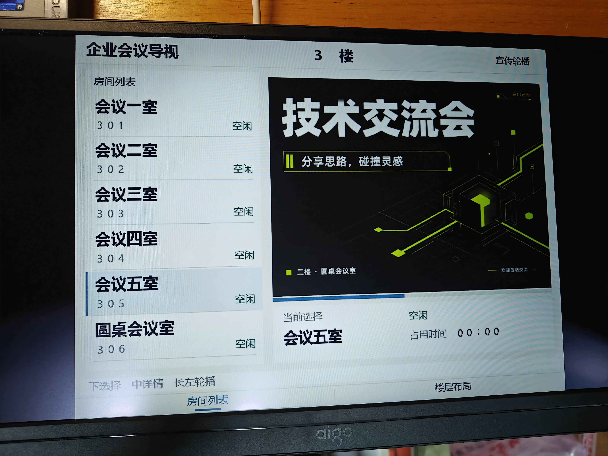

# 楼宇多媒体导览系统

基于康芯 HX4S20C／安路 EG4S20BG256 的单 FPGA 导视终端。系统从 TF 卡读取图片、配置、字模和 WAV 音频，在 HDMI 屏幕上联动显示房间列表、楼层地图和详情照片。支持房间占用与计时、地图缩放和平移、图片滑动切换、原界面上的大图淡入淡出，以及声音频谱和参数面板。

本目录是完整复现交付版。源码、已验证位流和演示素材一起保存；先按下述步骤运行配套版本，再进行修改或重新编译。



## 先运行配套演示

1. 准备 HX4S20C 开发板、HDMI 显示设备、USB-JTAG 数据线、FAT32 格式 TF 卡及读卡器。音频演示需要能接收 HDMI 声音的显示设备或音频输出设备。
2. 将 `TF_CARD` **里面的 77 个文件**复制到卡根目录，包括 `SITE.CFG`、69 张 BMP 和 7 个 WAV。不要把 `TF_CARD` 文件夹本身作为卡根目录下一层。
3. 按 [接线与按键说明](docs/01_接线与按键.md) 连接 HDMI A、USB-JTAG 和按键；断电插好 TF 卡，再上电。
4. 在安路下载工具中选择 JTAG 配置 FPGA，下载 `release/image_nav_cache_tailfix_seed61_untested.bit`。文件沿用构建时名称，实际板级验证记录见 `release/board_verification.json`。
5. 等待初始图片出现。按上进入房间选择，确认打开详情，再确认打开完整照片；按返回逐层退出。完整操作和验收步骤见 [复现与验收](docs/02_复现与验收.md)。

配套位流 SHA-256：`08170d73721e6962a7bc4e840f9ea6f090a0e8bea38980df77d1637189e0d134`。

## 从源码编译

使用 Tang Dynasty **6.2.168116**，打开 `src/td_project/image_multiview_gui.al`。器件为 EG4S20BG256，顶层为 `top`；使用 `syn_1` 综合和 `phy_seed61` 物理实现策略。工程中已包含所需 RTL、IP、约束和初始化文件。

也可用 Python 调用随包复现入口。将下面安装目录替换为自己的 TD 安装目录：

```powershell
python tools/reproduce.py build --td-root "D:/anlu"
```

脚本复制源文件后构建，输出放在 `.repro_work/build_日期时间/`，完成后打印新位流路径。GUI 操作、工具依赖和脚本说明见 [编译与配置](docs/03_编译与配置.md)。

## 文件核验

Python 3.10 及以上即可核对文件完整性、工程引用、图片索引和 TF 卡格式；该检查不需要第三方 Python 包：

```powershell
python tools/reproduce.py check
```

修改文字时，安装配置工具依赖后运行中文编辑器：

```powershell
python -m pip install -r scripts/requirements_reproduction.txt
python scripts/site_content_editor.py
```

已交付的 `SITE.CFG` 内含本次所需字模，直接演示无需安装字体或重新导出配置。文字、文件名和素材更换方法见 [内容编辑器说明](docs/content_editor.md) 与 [编译与配置](docs/03_编译与配置.md)。

## 目录

| 目录 | 内容 |
|---|---|
| `src` | 可打开的 TD 工程，完整 RTL、IP、约束及初始化文件 |
| `TF_CARD` | 与本次演示对应的卡根目录文件，直接复制使用 |
| `release` | 已验证位流、版本清单、已有资源及时序报告 |
| `config` | 内容草稿、字模基准、配置样例及配套 `SITE.CFG` |
| `scripts` | 中文表单编辑器、配置与字模生成源码 |
| `sim` | 仿真测试台和测试输入 |
| `tools/reproduce.py` | 文件核验、独立构建、配置一致性检查和缓存回归入口 |
| `tools` 其余文件 | 开发阶段的构建、测试和对照工具源码，说明见编译文档 |
| `docs` | 接线、按键、复现验收、编译配置和源码阅读说明 |

源码阅读从 [模块入口说明](docs/源码阅读说明.md) 开始。交付对应 2026-10-16 尾槽修复版；整理只改变 RTL 排版与注释。原发布版上板验证、当前静态时序边界及本次电脑端核验分别记录在 [版本与验证](docs/04_版本与验证.md)。

## GitHub 提交

将本目录作为仓库根目录，保留 `TF_CARD` 与 `release`。`.gitignore` 已排除构建产物，`.gitattributes` 保留交付文件的原字节，克隆后可再次运行哈希核验。源码、位流、素材及说明应在同一个提交中固定版本。第三方文件来源见 [来源说明](THIRD_PARTY_NOTICES.md)。
