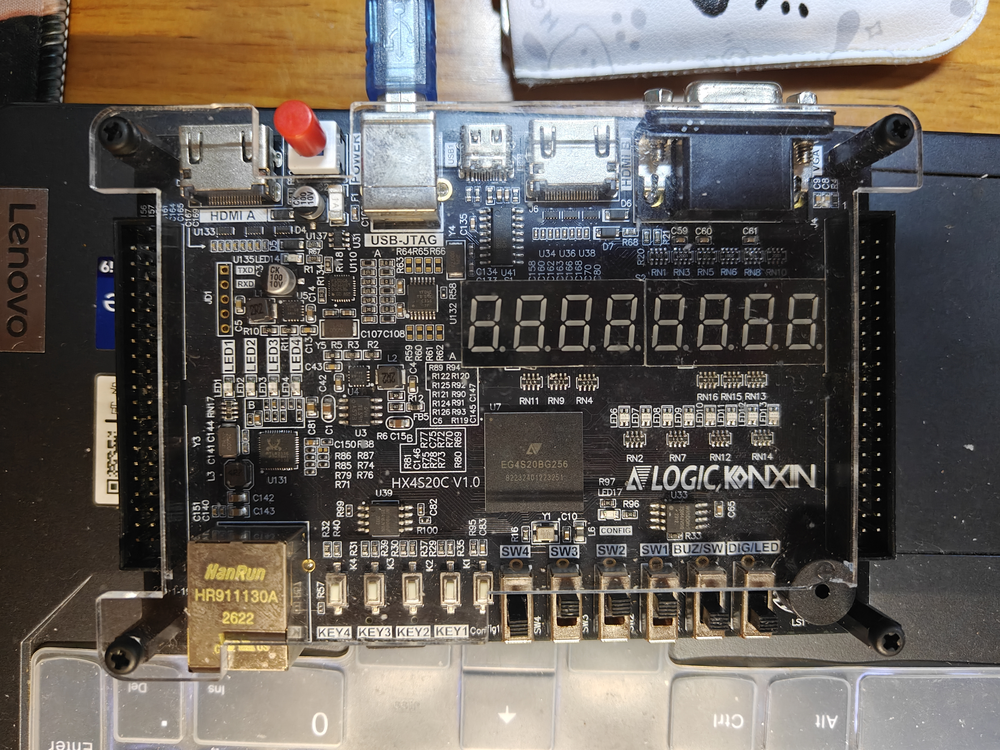
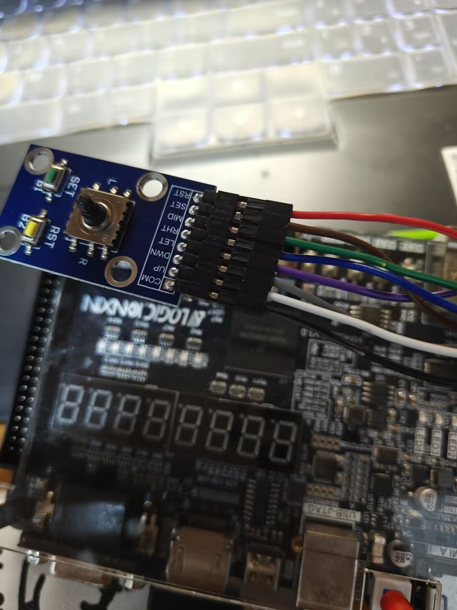
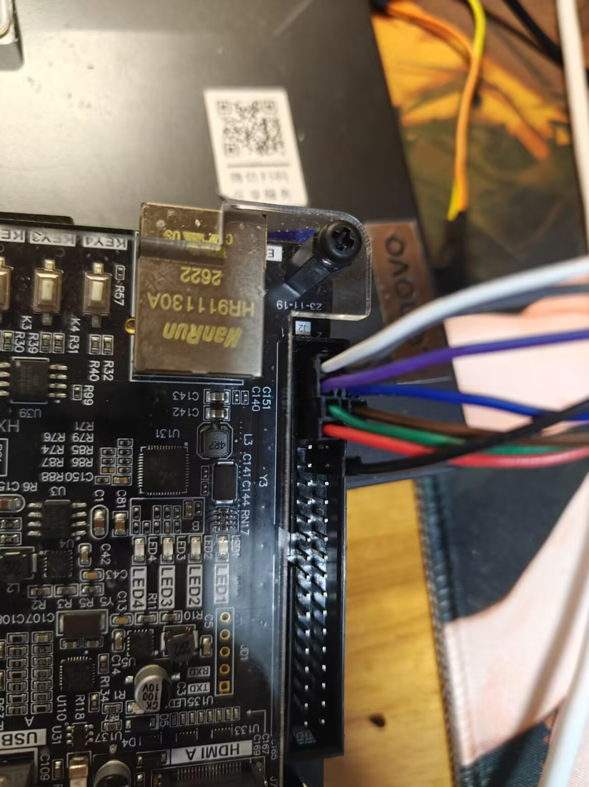

# 接线与按键

## 硬件连接

本工程使用康芯 HX4S20C 开发板，FPGA 型号 EG4S20BG256。HDMI 显示器接板上 **HDMI A**，电脑通过 USB-JTAG 连接开发板。TF 卡插入板上卡槽；使用 FAT32 文件系统和 512 字节逻辑扇区。下载工具及 USB-JTAG 驱动随安路工具或赛题开发板资料安装。

外接模块是共端机械按键，COM 接 GND，其余按键信号接 FPGA 输入，由工程启用内部上拉；按下时为低电平。接线前断电。模块上的 RST 在本工程中作为返回键使用。

| 模块端子 | J2 物理针号 | FPGA 管脚 | 用途 |
|---|---:|---|---|
| COM | 12 | GND | 公共地 |
| UP | 1 | P4 | 上 |
| DWN | 2 | N4 | 下 |
| LFT | 3 | N3 | 左 |
| RHT | 4 | M5 | 右 |
| MID | 5 | M3 | 确认 |
| SET | 6 | M4 | 参数面板 |
| RST | 7 | L3 | 返回 |

J2 是双排插针，按板上 1 脚标识和实际针号定位，不能沿一整排顺数成 1～7。接线表与 `src/user_source/constraints_source/pin.adc` 一致。以下照片用于辨认连接位置，线色不是接口定义。

板载按键同时保留：KEY4＝上，KEY3＝下，KEY2＝左，KEY1＝右。SW1＝参数面板，SW2＝轮播布局选择，SW3＝返回，SW4＝确认。SW1、SW3、SW4 每次拨动产生一次操作；SW2 按电平选择布局，0 为列表及480×360轮播，1 为居中640×480轮播。仅用板载按键也可以完成下面的全部操作。

## 基本手势

方向键短按在松开时触发，长按约 800 ms 触发一次；长按后松手不会再补发短按。MID、SET、RST 为按下触发。

| 当前界面或状态 | 操作 | 结果 |
|---|---|---|
| 索引页，尚未框选房间 | 短按上 | 框选本层第一个房间 |
| 房间选择 | 短按下 | 选择下一个房间，到末尾回到第一个；列表随选择滚动 |
| 房间选择 | 长按上 | 切到上一层，到最高层后回第一层 |
| 房间选择 | 确认 | 打开该房间详情 |
| 房间选择 | 短按右 | 进入地图并选择对应观察点；地图未准备好时先等待加载 |
| 索引页，无详情面板 | 短按左 | 手动播放下一张宣传图 |
| 索引页，无详情面板 | 长按左 | 开启／关闭自动轮播 |
| 页面选择状态 | 索引页短按右／地图页短按左 | 切换到地图／索引页面 |
| 地图页，页面选择状态 | 短按上 | 进入楼层选择，先预选当前楼层 |
| 楼层选择 | 短按上 | 循环预选更高楼层 |
| 楼层选择 | 确认 | 显示预选楼层，仍停留在楼层选择状态 |
| 楼层选择 | 短按左 | 进入本层第一个观察点的选择状态 |
| 观察点选择 | 短按右 | 循环选择下一个观察点，视野随目标移动 |
| 观察点选择 | 确认 | 打开观察点详情 |
| 观察点选择或地图平移 | 长按右 | 循环切换地图三档缩放 |
| 观察点选择或地图平移 | 长按左 | 在观察点选择与四向平移之间切换 |
| 地图平移 | 短按上下左右 | 移动视野，自动选择靠近视野中心的观察点 |
| 已选房间／观察点，或其详情 | 长按下 | 切换占用状态，计时随状态更新；平移或完整大图状态不执行此操作 |
| 详情面板完全打开 | 再次确认 | 完整 640×480 照片在当前界面上淡入 |
| 完整照片 | 返回 | 淡出照片，回到原详情面板 |
| 详情面板 | 返回 | 关闭详情，回到原选择状态 |
| 地图平移 | 返回 | 回到观察点选择 |
| 房间、楼层或观察点选择 | 返回 | 回到页面选择，取消框选 |

## 参数面板

SET 或 SW1 打开／关闭面板；返回键也可退出。上下键循环选择亮度、音量、频谱、背景音乐，左右键调整或切换。**面板内按 MID／SW4 切换最近邻与双线性采样**。

背景音乐默认关闭。演示音乐与频谱时，先打开参数面板，选择背景音乐并开启，确认显示设备音量已打开。亮度范围为 2～8，音量为 0～8；这两项是工程内部档位。

## 轮播布局

SW2=1 时图片位于 (80,60)，大小640×480，蓝色进度条紧接图底。SW2=0 返回列表布局；需要选择房间或打开房间详情时使用此布局。内容区布局过渡约0.56秒；正在滑动或详情面板打开时，等待当前操作结束后再切换。长按左控制自动轮播，短按左手动下一张。地图页用长按左切换选点与平移。
